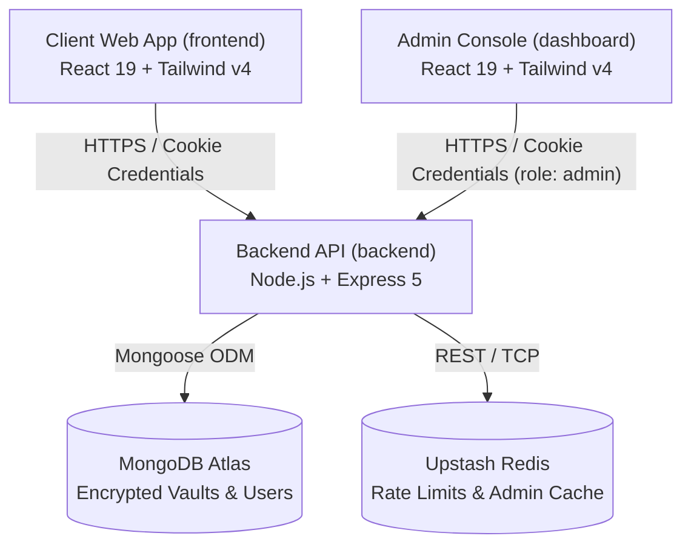

# Keynest — Monorepo Architecture & Project Overview

**Keynest** is an end-to-end, zero-knowledge password management platform built with modern web standards, cryptographic security, and cloud scalability.

---

## 🏛️ High-Level System Architecture

The project is structured as an integrated multi-project monorepo containing the REST API backend, the public client web application, and the administrative console:



---

## 📁 Repository Structure

```
Password Manager/
├── backend/            # Express 5 REST API, cryptographic utilities & MongoDB models
├── frontend/           # Client web application (User Landing, Auth, and Password Vault)
├── dashboard/          # Privileged Admin console for user management & platform auditing
├── keynest-extension/  # Cross-browser extension (WXT + TypeScript)
└── README.md           # Master repository documentation
```

---

## 📦 Project Summaries & Documentation Links

| Component | Tech Stack | Port (Dev) | Description | README |
| :--- | :--- | :--- | :--- | :--- |
| **Backend** | Node.js, Express 5, MongoDB, Upstash | `7000` | Secure API handling AES-256 vault encryption, Bcrypt with 72-byte limit, atomic recovery code rotation, and serverless compatibility. | [Backend README](backend/README.md) |
| **Frontend** | React 19, Vite, Tailwind v4, React Router 7 | `5173` | User-facing application featuring neo-minimalist black/white aesthetic, multi-user theme persistence, and full vault CRUD. | [Frontend README](frontend/README.md) |
| **Dashboard** | React 19, Vite, Tailwind v4, Lucide React | `5174` | Admin dashboard for inspecting registered accounts, auditing platform metrics, and managing users with zero access to credentials. | [Dashboard README](dashboard/README.md) |
| **Extension** | WXT, React, TypeScript | — | Browser extension for automated credentials detection and autofill. | [Extension README](keynest-extension/README.md) |

---

## 🚀 Quick Start Guide

### 1. Start Backend API
```bash
cd backend
npm install
npm run start
```
*API will run on `http://localhost:7000`.*

### 2. Start Frontend Web App
```bash
cd frontend
npm install
npm run dev
```
*App will launch on `http://localhost:5173`.*

### 3. Start Admin Dashboard
```bash
cd dashboard
npm install
npm run dev
```
*Dashboard will launch on `http://localhost:5174`.*

---

## 🔒 Security Principles

* **Zero Plaintext Credentials:** Vault passwords and usernames are encrypted client/server-side with AES-256 prior to database persistence.
* **HttpOnly Session Cookies:** JWT tokens are transferred through secure, sameSite, httpOnly cookies completely immune to client-side XSS theft.
* **Atomic Single-Use Recovery Codes:** Generated upon registration and atomically rotated whenever a password is reset, preventing code reuse.
* **Isolated Admin Boundary:** Administrative accounts are verified with explicit role checks (`role === 'admin'`). Admin APIs have zero mathematical ability to decrypt user vaults.
